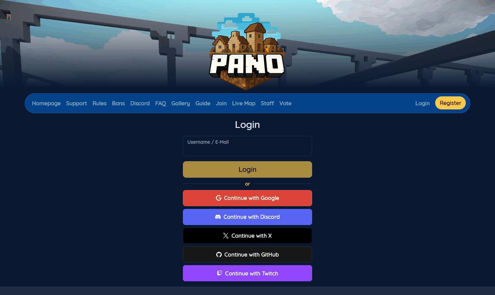
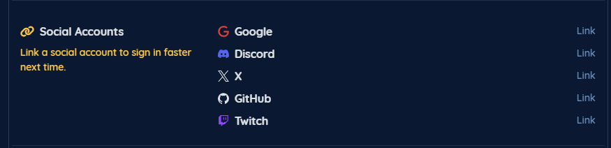
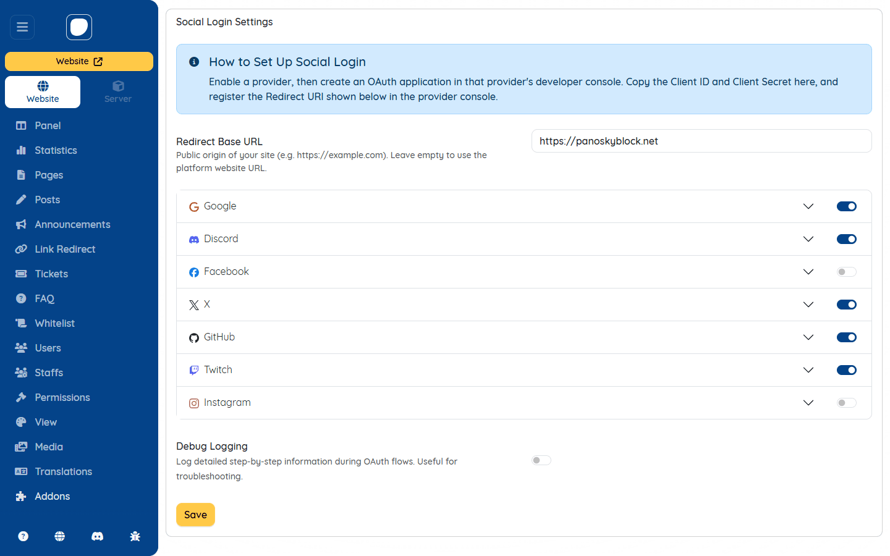

  
  <h1>Social Login</h1>
  
<b>Let players sign in with Google, Discord, X, Twitch and more in one click.</b>

  

    
    
    
  

Social Login adds one-click sign-in buttons to your Pano website, so players can join your community with an account they already have. New players sign up in seconds, and existing players can link several accounts to their profile. You turn each service on or off from the panel.

## ✨ Features
- 🌍 **Seven popular services**: Google, Discord, Facebook, X, GitHub, Twitch and Instagram.
- ⚡ **One-click sign-up**: New players create an account with a social account and just pick a username.
- 🔗 **Link many accounts**: Players connect several social accounts to one profile from their settings.
- 🎨 **Brand-colored buttons**: Clear buttons with each service's icon and color on your sign-in and sign-up pages.
- 🧭 **Built-in setup guides**: Step-by-step help in the panel for creating each service's app.
- 🛠️ **Staff controls**: See and remove a player's linked accounts from their player page.
- 🔒 **Secrets stay hidden**: App secrets are only shown after you confirm your password, and every change is logged.

## 📸 Screenshots

<i>Players link or unlink their social accounts from their settings.</i>

<i>Switch each service on or off from one settings page.</i>

## 🚀 Get started
1. Open your Pano panel and go to **Addons**.
2. Find **Social Login** and click **Install**.
3. In the addon's **Settings** tab, turn on a service and follow its setup guide to add your app details.

## 💬 Support
Questions or ideas? Join our [Discord](https://panomc.com/discord) or visit [panomc.com](https://panomc.com).

## 📄 License
Released under the MIT License.
